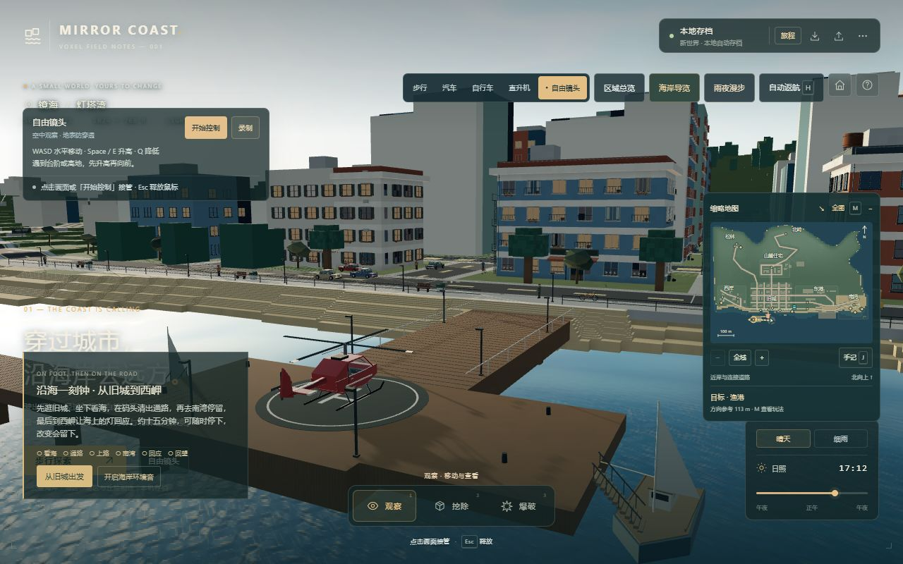
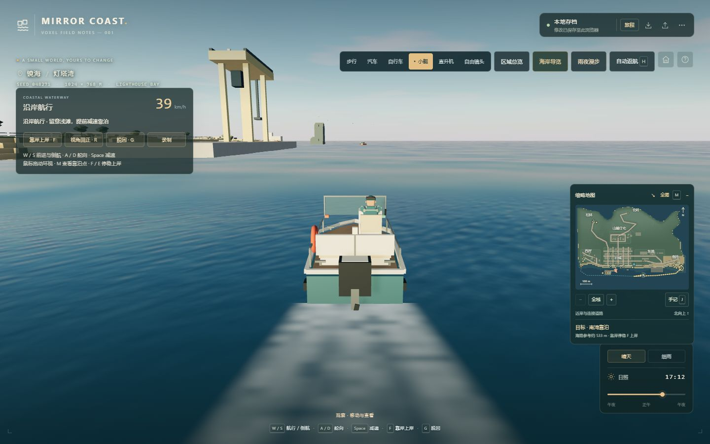
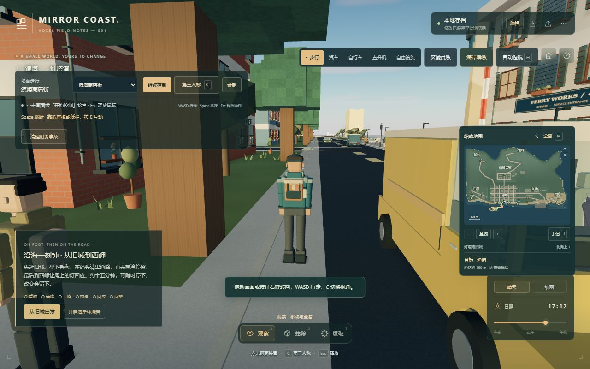
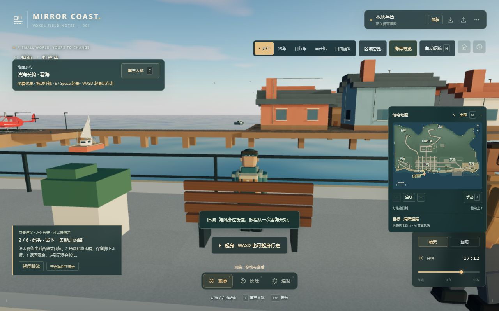
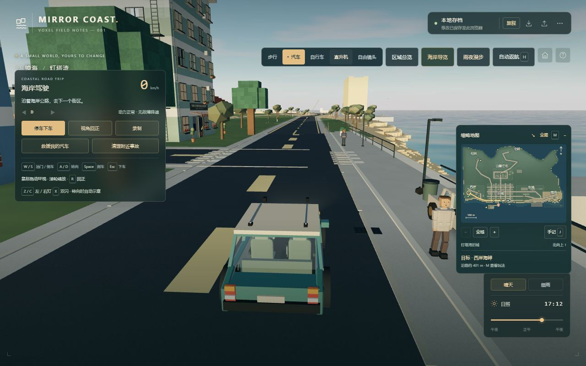
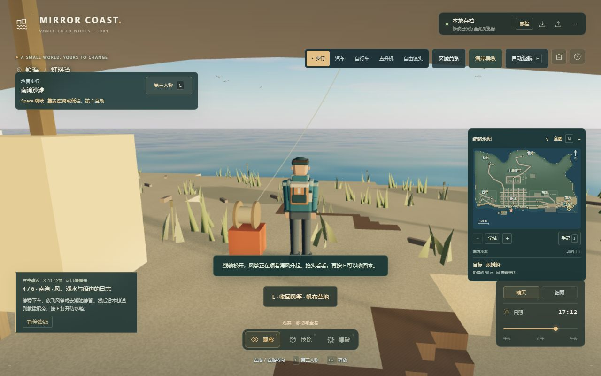
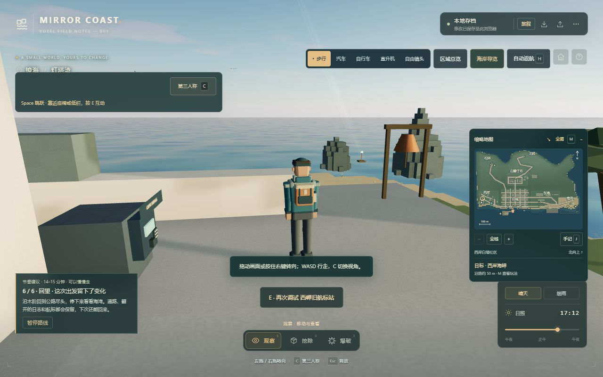
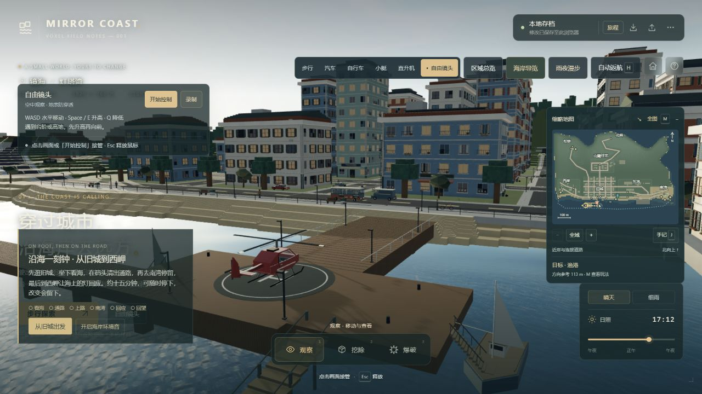

# 镜海 · Mirror Coast

**一座可以步行、骑行、驾驶、飞行、改变并保存的浏览器体素海滨城市。**

从旧城沿海堤走到码头，清出支栈桥，驾车去南湾，在西岬接通航标。清出的通路、探索记录与载具位置会留在这份世界里。

**[打开在线试玩](https://yydshly.github.io/mirror-coast-web/)** · [操作与推荐路线](#第一次游玩) · [部署说明](docs/DEPLOYMENT.md) · [项目结构](docs/ARCHITECTURE.md)

> 当前为持续开发的单机原型。地图是程序生成的虚构沿海区域，约 1024 × 768 米；本项目不声称重建真实地球或接入实时地理／天气数据。推荐使用有硬件加速的桌面浏览器、键盘和鼠标。



2026-11-17 已上线。载具脱困及刷新恢复已实测；斜向车辆旁的通行继续扩展复核到停放事故车、直升机附件更新及骑手头部净高，G 脱困已加入各载具的操作提示。[载具范围复核](docs/VEHICLE-RANGE-AUDIT.md) · [斜车旁通行实测](docs/TRAFFIC-CONTACT.md) · [脱困说明](docs/RECOVERY.md) · [首次发布验证记录](docs/DEPLOYMENT.md#本次发布验证)

汽车与行人的接触现区分低速踉跄和较快跌倒，停车后行人会在安全处起身、走回路线；实际接触不会再一律当成撞墙。[行为说明与旧城实机记录](docs/PEDESTRIAN-CONTACT.md)。

海岸行驶现区分水线沙地和深水；涉水停驶会明确提示，G 救援也覆盖远离公路的海岸。水下镜头有海面背面与水色雾，避免将海底误看成普通沙滩。[海岸与涉水说明](docs/SHORE-DRIVING.md)。

同类问题已扩查到人物、自行车与直升机：水线沙地正常通行，深水原因与恢复方式明确；海面不再盖住可站立的水线陆地。[海岸各模式复核](docs/SHORE-MOBILITY.md)。

**新增可驾驶海岸小艇。** 从码头走下木阶，按 E 上船，沿海路去南湾或西岬；靠泊后 F 上岸，接着步行探索。小艇支持惯性航行、倒航、浮动与横倾、舵机／驾驶员、贴合海面的尾迹、夜间航行灯和海上存档恢复。M 地图已标出三处靠泊点。[操作与实机记录](docs/BOATING.md)。

小艇与沿岸渔船共享实体碰撞，渔船会临时让行；桥下按实际净空通行。高速接近低沙岸可以惯性冲滩并搁浅，停稳后 F 上岸或 G 脱困，搁浅状态也会保存。低栈桥、陡岸与礁石仍需绕行。



## 演示

以下为游戏实机画面，不是概念图。发布截图与历史实机截图的来源、时间和覆盖范围见 [演示记录](docs/DEMO.md)。

| 场景 | 画面 |
| --- | --- |
| 上线版本：旧城步行 |  |
| 海堤坐下看海 |  |
| 旧城街道与沿海道路 |  |
| 南湾：风筝、潮池与救援船 |  |
| 西岬：调试航标，观察海上回应 |  |

## 第一次游玩

1. 打开试玩，等待场景准备完成。点击「开始控制」或场景接管鼠标；按 Esc 释放。
2. 在路线卡选择「从旧城出发」。约十五至二十五分钟，可随时停下、自由探索和保存。
3. **旧城 → 海堤：** 步行到海边，靠近长椅按 E 坐下；E、Space 或移动可起身。
4. **码头：** 去支栈桥，按 2 挖除挡路木箱，保留脚下木板；按 1 回到观察，靠近记录台按 E 读日志。
5. **海岸路 → 南湾：** 找到自行车或旅行车，靠近按 E 上车。沿地图前往南湾，停车后放风筝或看潮池，再读救援船旁的日志。
6. **西岬：** 沿西岸公路上山，停车、下阶，调整航标至 205° 并确认，观察海上标灯回应。
7. 完成后可继续去松林电台、北岭观景点，或回旧城散步。J 打开手记，M 打开地图。

只是想看风景，也可使用「区域总览」「海岸导览」或自由镜头。直升机支持手动驾驶、自动返航落地和安全下机。

## 能做什么

- **人物探索：** 第一／第三人称、跑步、跳跃、坐下起身、翻越合适的低栏。
- **载具：** 自行车、旅行车、直升机、海岸小艇；鼠标环视、载具脱困和附近事故清理。
- **环境：** 日夜、雨、海水、街道行人与车流、海岸和外围地形。
- **改变世界：** 挖除、爆破、结构失撑与落定废墟；局部地形、道具和探索状态保存。
- **探索：** 缩略地图、路线与手记，码头清障、南湾风筝／潮池、西岬航标、松林电台。
- **录制：** F9 打开录制；纯场景模式与包含页面文字／地图的标签页录制。页面录制须在浏览器选择器中手动选择当前标签页。

## 常用操作

| 模式 | 操作 |
| --- | --- |
| 通用 | 鼠标环视；Tab 帮助；M 地图；J 手记；Esc 释放操作／关闭面板 |
| 步行 | WASD 移动，Shift 跑步，Space 跳跃，E 附近互动，C 切换人称 |
| 工具 | 1 观察、2 挖除、3 爆破；接管后鼠标左键使用工具 |
| 自行车 | W 蹬车，S 制动后退行，A/D 转向，Space 刹车；停稳后 F/E/Esc 下车 |
| 汽车 | W 油门，S 制动后倒车，A/D 转向，Space 刹车；F/Esc 停车下车 |
| 车灯 | Z/C 左／右转向灯，X 双闪；R 载具视角回正 |
| 直升机 | W/S 前后，A/D 转向，Q/E 侧移，Space/Shift 升降，F 落地后下机 |
| 小艇 | W 加速，S 制动后倒航，A/D 操舵，Space 减速；靠岸停稳后 F/E 上岸，G 脱困 |
| 自动返航 | H 切至直升机并自动驾驶回停机坪；飞行中的界面提示说明接管方式 |
| 载具脱困 | 驾驶自行车、汽车、直升机或小艇时按 G；对应面板也有脱困／救援按钮 |
| 录制／展示 | F9 录制；F8 切换展示界面 |

按键随当前模式和面板状态变化，以游戏内 Tab 帮助和上下文提示为准。坐下、登车、翻栏等需要附近有可用对象及安全落脚空间。

卡在墙边、窗台或楼檐处，可按 **G** 对当前载具执行一次安全脱困。自行车检查轮组和骑手空间，直升机检查旋翼、尾部与机身后在附近悬停；汽车优先寻找附近公路，也检查岸上安全地面，必要时检查地图内更远的实际道路。世界破坏和探索记录继续保留；没有合适位置时会明确提示。[说明与实机记录](docs/RECOVERY.md)。

## 保存、从头开始与跨网址迁移

进度保存在**当前浏览器、当前网址的 IndexedDB**，无需注册，不会上传到服务器。

- 刷新页面会恢复上次保存的世界；「旅程 → 从头开始 · 保留旧存档」可创建独立旅程。
- 右上角可以导出／导入 JSON。建议大规模破坏或更换设备前先导出。
- 本地 localhost、GitHub Pages、其他域名或另一浏览器的存档彼此独立。迁移时在原网址导出，再到新网址导入。
- 清除站点数据会影响本地存档；无痕模式的保留期限受浏览器控制。
- 世界有编辑／废墟数量上限，达到限制会提示。没有多人共享世界、云端同步或离线城市自动经营。

## 本地运行

需要 Node.js 22.12+（推荐 Node 22）和 npm：

```bash
npm ci
npm run dev
```

开发地址为 `http://127.0.0.1:5173/`。端口被占用时可指定：

```bash
npm run dev -- --port 5175
```

验证与生产构建：

```bash
npm test
npm run build
npm run preview -- --port 4173
```

生产文件输出到 `dist/`。这是纯静态站点，不需要运行 Node 后端、数据库或配置 API 密钥。

## 发布

`main` 分支推送后，GitHub Actions 执行锁文件安装、测试、构建并发布 GitHub Pages。Pull Request 只运行检查。

资源使用相对基础路径，兼容 `/mirror-coast-web/` 项目网址。发布记录、复现方法和其他静态托管设置见 [DEPLOYMENT.md](docs/DEPLOYMENT.md)。

## 启动失败与建筑表现

WebGL 创建失败时会显示可操作的恢复页面，提供重新加载、图形加速设置、完整重启和 GPU 诊断步骤，保留当前旅程与存档。[恢复方法与验证记录](docs/STARTUP.md)。

旧城建筑已做一轮整体层次调整：用与墙色匹配的薄覆层收细抹灰建筑原来一米高的白色楼层横带，增加分层檐线和转角立柱；住宅、较高街楼、厂房分别使用阶梯屋顶、顶部退台和低天窗轮廓。沿用现有批量渲染、碰撞和破坏锚点。原始体素基础、建筑编号与存档键保持一致；覆层不遮盖已有破坏或被玩家修改过的横带。

这仍是体素原型的第一轮建筑改善；住宅整体体量、首层空间与室内尚未完成美术重做。



## 已知限制

- 旧城密集街区和连续破坏仍可能出现慢帧，历史记录有约 100ms 的偶发停顿。更长的历史事件未稳定复现；不承诺整张地图稳定 60 FPS。
- 复杂事故、密集废墟、狭窄近景仍可能有接触或镜头问题；已有救援与清理附近事故入口。
- 场景需要 WebGL2 和硬件加速。首次生成、着色器准备和低性能设备加载可能较慢。
- 手机可尝试查看；当前游玩以桌面键鼠为主，未完成触屏完整验收。
- 大多数住宅室内尚未开放。现有探索是有限内容，不会自动生成无限任务。
- 浏览器标签页录制、声音与鼠标锁定受浏览器权限和兼容性影响。

## 技术与范围

TypeScript · Three.js / WebGL2 · Rapier 3D · Vite · Vitest · IndexedDB。

本仓库是沿海城市原型的独立发布子项目，保留已有游戏能力。本次发布集中在远端访问、自动部署、文档和演示，不增加新玩法或扩大地图。

底层依赖的版本与许可证见 [THIRD_PARTY.md](docs/THIRD_PARTY.md)。

