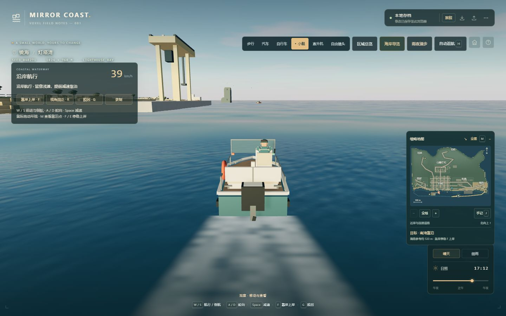
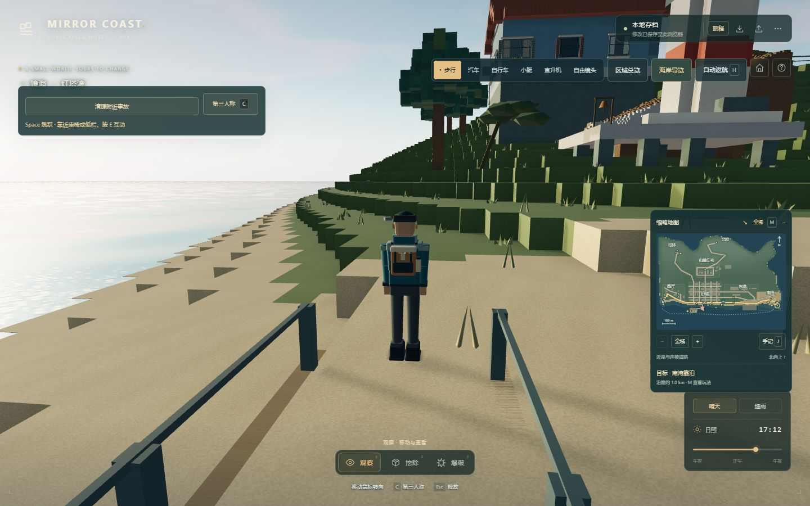

# 海岸小艇

2026-11-17。第一版可驾驶动力艇，连接现有海岸的水路与岸上探索。

## 从哪里开始

在顶部选择「小艇」可以直接接管当前船只；也可以从停机坪南侧的小艇栈桥走下木阶，到船旁按 E 登船。

M 地图中有「码头靠泊」「南湾靠泊」「西岬靠泊」三处落点，蓝色虚线表示海路参考。航线由玩家手动驾驶；接近栈桥应提前收油、减速。靠泊下船后，人物面向岸上木阶，可以按 W 接着走。

| 按键 | 作用 |
| --- | --- |
| W / S | 加速前进／制动后低速倒航 |
| A / D | 操舵；转弯需要航行速度 |
| Space | 减速停车 |
| F / E | 停稳并找到安全落脚点后上岸；行驶中先减速 |
| G | 搜索安全深水脱困，清除旧速度和输入 |
| 鼠标拖动／滚轮／R | 环视／缩放／视角回正 |
| M / Tab / F9 | 地图／当前操作说明／录制 |
| H | 切换到直升机并自动返航；小艇留在原位 |

深水中按 F 会说明没有安全上岸位置，并保留驾驶模式。水太浅、岸边礁石或实体障碍会阻挡船体，可以倒航退回；G 仍检查实际水深和完整船体空间。没有安全位置时不强制移动船只。

## 实现范围

- 小型敞舱动力艇，木甲板、座椅、驾驶台、方向盘、外挂机和救生圈；驾驶员的手连接方向盘握点，脚落在甲板上。
- 带惯性的浮航控制，最大前进速度约 41 km/h；有倒航、低速操舵、减速和停靠。浮动与俯仰使用现有海面的低频波参数，转弯有轻微横倾。
- 碰撞读取权威体素与场景附件，使用分段船体和驾驶员净高；移动采用短距离步进，浅滩与地面不是可航行水面。
- 尾迹合成在实际海面着色中，不会被波峰遮住或浮在水面上方。左红右绿与船尾白灯随夜色调整。
- 三处低位木栈桥以实际岸地和海床为基础，带小于 20 厘米的踏步与连续扶手。靠泊点两侧留出登离船位置。
- 船位、朝向、驾驶状态和地图目标写入现有存档；海上刷新后仍在船上，速度归零。波浪相位不写入存档，停泊时也不会仅因小幅起伏反复保存。

这是适合现有浏览器场景的简化浮航控制：运动、碰撞和视觉反馈已接通，浮力与浪涌采用近似计算。

## 模块

| 文件 | 职责 |
| --- | --- |
| `vehicles/coastal-boat.ts` | 操控、水深、船体碰撞、上下船、脱困、跟随镜头 |
| `vehicles/boat-model.ts` | 船体、驾驶员、操纵件和航行灯 |
| `route/boat-route.ts` | 三处泊位与海路参考 |
| `rendering/boat-landings.ts` | 低位栈桥、岸上连接踏步与碰撞 |
| `rendering/water-surface.ts`、`rendering/environment.ts` | 海面高度和贴合海面的尾迹 |
| 现有输入、地图、录制和存档模块 | 按模式路由按键、标识当前位置、保留船位及恢复驾驶 |

## 实际游玩验证

在独立临时 Edge 与原生 JSON 测试存档中操作，不接管玩家当前预览：

1. 从停机坪附近步行走下木阶，E 上船、F 下船、再上船。驶离码头后，深水 F 保留在船上并给出原因，G 后可继续驾驶。
2. 海上导出、刷新和再导出，船位、驾驶状态与地图目标保留，体素编辑集合不变。
3. 使用正常 W/S/A/D/Space 按键，连续从码头沿海航行至南湾，经过约 `(275,262)`、`(480,254)`、`(650,236)`，最后在约 `(703.5,189.4)` 靠泊并下船。
4. 西岬另从近岸水域驶入泊位后下船。三个泊位分别复核了“F 上岸—W 沿木阶走回现有岸地”，均可通过；岸地高度分别为约 15、12、15 米。
5. 检查白天巡航的船体、尾迹和夜间驾驶员／航行灯近景；浏览器没有运行或着色器错误。

核心检查覆盖加速与惯性、操舵和倒航、浅滩退行、实体障碍与桥下净高、拒绝深水下船、G 成功／失败、三个真实泊位双向步行以及旧存档兼容。完整回归 108 个文件、706 项通过；后续视觉收尾完成了相关回归和生产构建，发布流程再次执行完整检查。

| 实际航行与海面尾迹 | 西岬下船后接上步行 |
| --- | --- |
|  |  |
