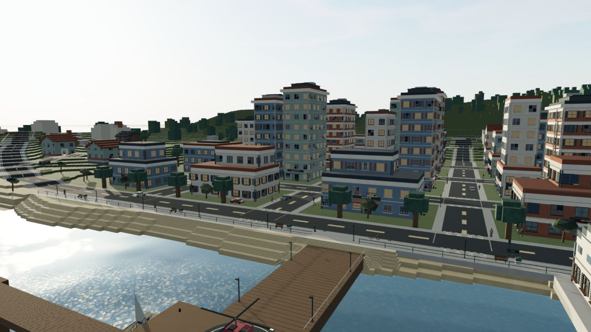
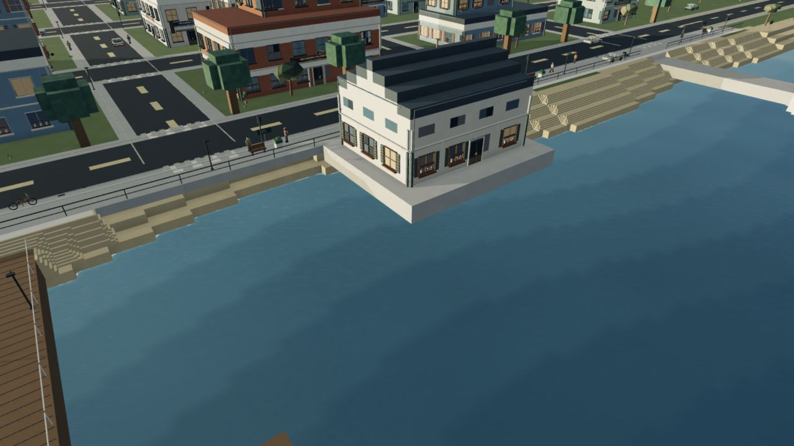

# 建筑形体调整

目标是让沿海前排、旧城街角和码头仓库具有不同的整体轮廓。沿海道路和地面入口保持原位，避免为了改造建筑打断现有路线。

- 沿海商铺：保留完整的低层店面，上层住宅偏置并后退，露出面向海岸的屋顶退台。
- 旧城街角：部分宽楼在共同基座上分成高低两翼；窄楼则让上层后退，降低临街墙面的压迫感。
- 码头仓库：降低檐口，增加沿长边延伸的阶梯坡顶，区别于住宅平顶。
- 窗户与建筑附件按各个实际楼体分段生成，上层住宅不重复生成底层店铺入口和橱窗。

## 数据与碰撞

`world/city-massing.ts` 在初始化阶段修改权威体素，渲染、射线编辑和碰撞使用同一份数据。改造只取用原建筑已有的占用单元，不扩展到道路或建筑边界之外；原建筑的所有权索引保持稳定，旧的整栋拆除记录仍可覆盖全部新形体。

加载顺序为：原始城市与区域生成 → 建筑形体改造 → 基础支撑捕获 → 玩家体素编辑与废墟恢复 → 建筑附件和物理系统。改造不在运行帧中反复执行，也不需要清空存档。已有保存的空洞、材质修改会覆盖改造生成的内容。建筑完整外形会随这次版本更新改变，旧的屋顶位置不再保证对应相同高度。

这是部分既有建筑的形体更新。没有新增室内、楼梯到达所有屋顶、全地图建筑美术或新的任务能力。

## 验证范围

- 自动检查原入口和底部体素不变、新楼体不超出旧所有权、退台能站立和移动、旧存档整栋拆除与材质修改继续生效。
- 内置浏览器独立旅程实测海面远景、仓库坡顶、街道靠近立面受阻与后退脱离。
- 在改造后的沿海楼体爆破，重新加载同一旅程后，缺口与碎块保留，继续处于步行模式。
- 全量 112 个测试文件、732 项检查通过。此次没有重新完成十五分钟全路线或极端破坏验收，也不把测试通过等同于所有场景已无问题。
