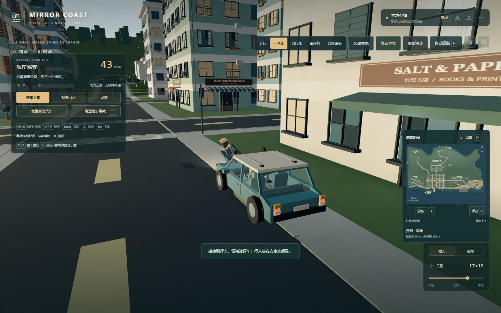
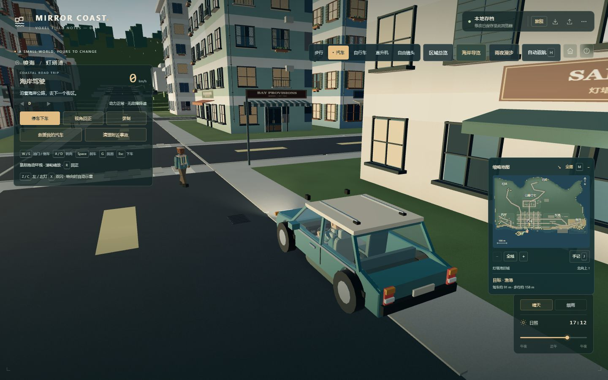

# 汽车与行人的碰撞反应

2026-11-17。此前行人只有导航控制的刚性障碍体，汽车会将撞人当成撞墙，行人则缺少与接触相符的动作。本轮补齐现有驾驶中的反应链路，不增加伤情、救护或警局系统。

## 现在的行为

- 相对速度低于约 3 米／秒（11 公里／小时）时，行人踉跄、侧步；较快接触时跌倒并用手臂护住身体。
- 接触后行人由约 70 千克的胶囊物理体控制，受重力、地面和障碍约束。画面与碰撞使用同一姿态，不保留站立时的隐形墙。
- 汽车受到有限减速；撞人本身不会触发撞墙后的刚体回稳或故障提示。真正的建筑、车辆、路障继续正常阻挡。
- 倒车和已经进入刚体状态的汽车也检查实际接触；车身旁真正有空隙时不会误报。
- 行人起身前核对地面、附近障碍、汽车未来一秒的行驶范围，以及完整起身过程的胶囊净空。仍与移动汽车接触时继续等待。
- 起身后先短暂停稳，再沿连续小步走回原路线，不瞬间传回原坐标。
- 碰撞提示明确要求减速停车，区别于汽车撞墙和翻覆的提示。

这是单个物理体配合肢体姿势的简化反应，并非完整关节布娃娃。行人仍沿用临时街景状态，不作为事故汽车或废墟写入存档。

## 复核

相关检查覆盖较快碰倒、低速碰触、倒车、侧向正常通过、刚体汽车、地面支撑、连续起身与行走，以及快速来车预测范围中的空档。原有完整检查 104 个文件／676 项通过，随后补充的预测回归与生产构建通过；最终发布检查以仓库 Actions 为准。

实机使用独立临时 Edge、1440×900 视口，通过游戏自带 JSON 导入设置旅行车起点 `(135.4, 16.85, 115.4)`。保留真实行人及其路线，暂时移除其他车辆以隔离问题；使用正常油门、刹车、鼠标环视和原生存档导出，没有设置运行时行人位置。

实际接触对象为旧城行人 7：

1. 从正常行走进入跌倒反应，汽车保持道路驾驶状态，未翻覆、未进入回稳。
2. 停车后观察到跌倒、起身、恢复连续行走；人物仍在场景中，没有消失或传回原路线。
3. 导出的交通事故集合为空，未将行人误存成事故汽车。页面异常为空。

测试浏览器受到渲染速率限制，本记录验证接触、动作状态和视觉位置，不用于证明旧城性能达标。

| 接触反应与减速提示 | 起身后继续行走 |
| --- | --- |
|  |  |
