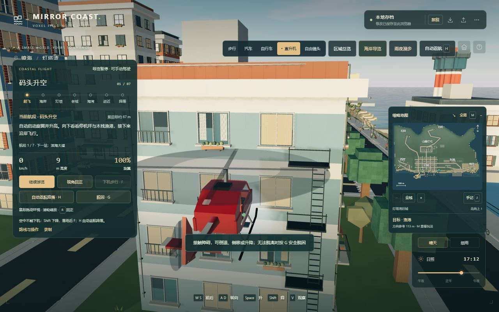
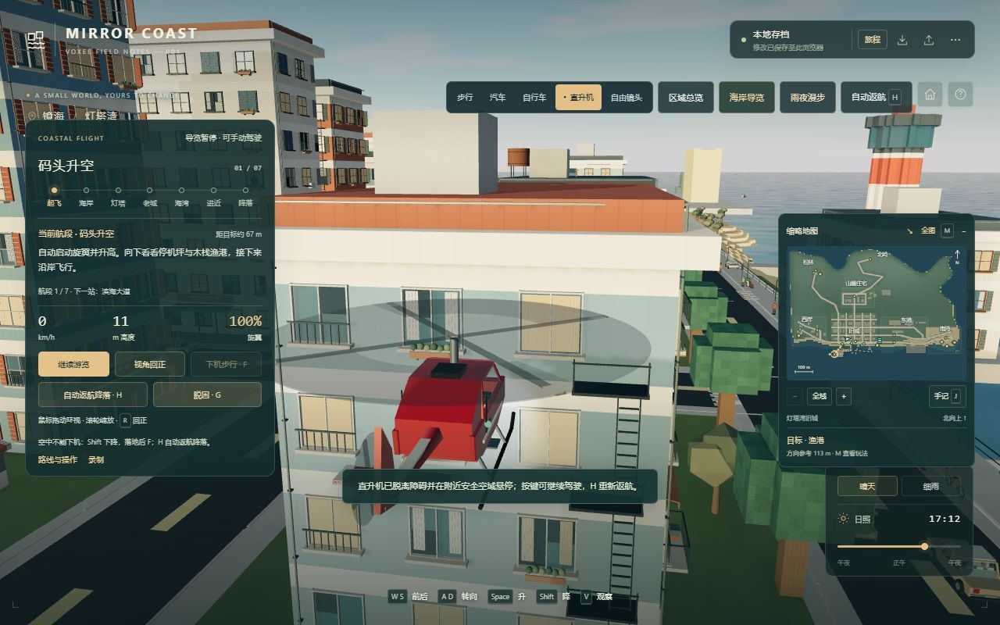
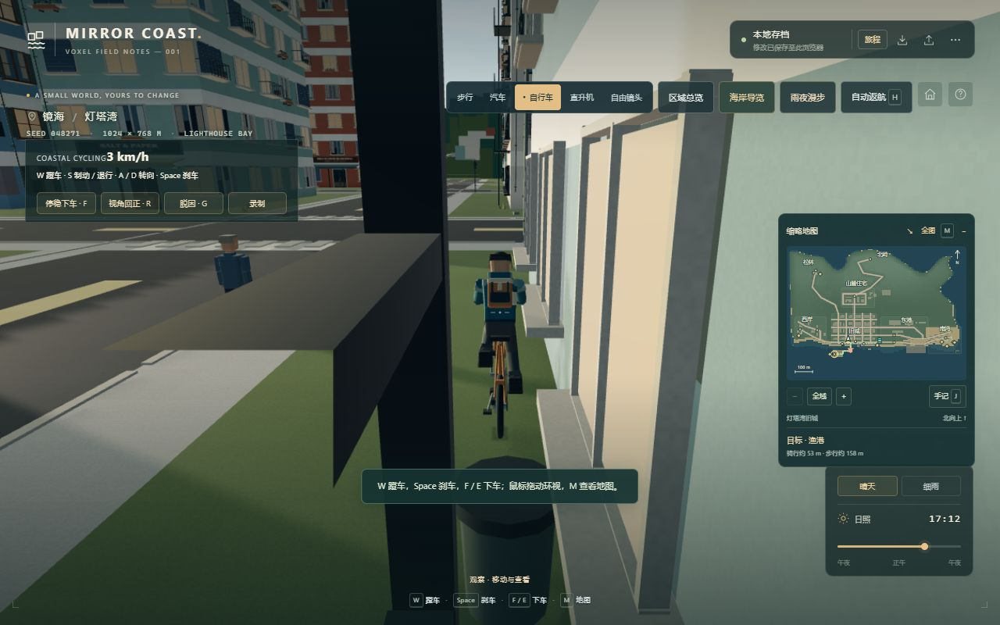
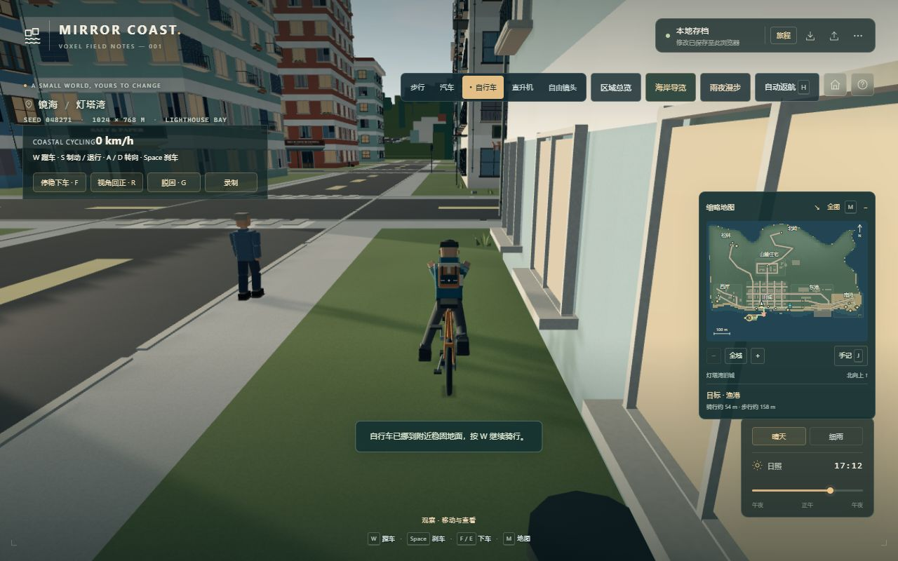

# 载具安全脱困

2026-11-17，解决车辆受阻后缺少可靠退路的问题，沿用现有场景、碰撞、救援和存档。

## 操作

- 驾驶自行车、汽车、直升机时，**G** 对当前载具执行一次脱困。
- 自行车和直升机面板有「脱困 · G」按钮。汽车保留「救援我的汽车」按钮，G接入同一入口。
- 持续尝试移动却没有进展时，飞机／自行车会给出明确提示。普通接触和等待仍有正常碰撞。
- H继续执行直升机自动飞行返航。脱困会暂停旧的飞行指令，随后可手动操纵或按H重新规划。
- G 也显示在骑行／驾驶／飞行时的底部操作提示和 Tab 帮助中，直升机常驻按键条也可见。

斜车旁原本可通行的空隙不应要求脱困。此类误阻挡另由真实朝向碰撞处理，见[斜向车辆旁的通行与镜头对照](TRAFFIC-CONTACT.md)。

## 安全条件

| 载具 | 接受的目标 |
| --- | --- |
| 直升机 | 附近有足够空间容纳机身、扫掠旋翼和尾部；同时核对未加载的权威体素、装饰和物理碰撞。落点修正姿态并悬停，清除旧速度和输入 |
| 自行车 | 检查 32 米内稳固岸地，必要时回退到实际道路；两轮有支撑，坡度适合，车身和骑手含头顶均无重叠，短距离出发通路可用 |
| 汽车 | 优先附近真实公路，随后检查岸边安全地面与地图内既有道路采样；四轮支撑、完整车体无重叠；岸边／远路回退还检查前方短距离可行驶 |

附近搜索次数有界。没有安全位置则保持原位并提示，用户可清理障碍后重试；不以删除建筑、清空世界或放宽碰撞来换取成功。

海岸不会因水线高度而误判成无支撑；自行车前方深水提示退行或 G，直升机海面悬停不再标为已落地。深水旧停机位置的 G 目标会检查水面上方的安全空域。[人物与载具的海岸复核](SHORE-MOBILITY.md)。

成功后保存新位置。当前其他载具、道路破坏、废墟、日志和路线状态继续保留。

## 实机复核

在独立临时Edge浏览器、1280×800视口，通过原生JSON导入建立旧城接触场景；使用正常按钮和键盘操作，未注入运行时位置设置器。

- 直升机飞向旧城外墙后受阻，点击脱困后向上离开接触高度，继续倒退飞行约9.50米；原生导出、刷新后的机体位置一致。
- 自行车在真实旧城窗台旁，按G移到旁边稳固地面，再骑行约3.49米；原生导出、刷新后的车位一致。这个接触位仍能短距离前进，不将其描述成已经复现所有死锁。
- 两组检查页面异常为空，刷新前后体素编辑集合一致。
- 新增回归覆盖楼檐／立面夹住、完全包围时拒绝、冷启动脱困后悬停、骑手头顶附件、持续受阻判断、各模式G键及H键保留。
- 最终101个测试文件、659项完整检查通过；TypeScript和生产构建通过。没有以测试结果代替上述真实场景操作。

以下为本地发布构建的实际检查截图：

| 直升机受阻 | 显式脱困后 |
| --- | --- |
|  |  |

| 自行车贴近窗台 | 挪到旁边安全地面 |
| --- | --- |
|  |  |

本次只处理受阻后的退路与状态一致性，不代表所有地点和事故组合都已验收，也不包含一般性能优化。
