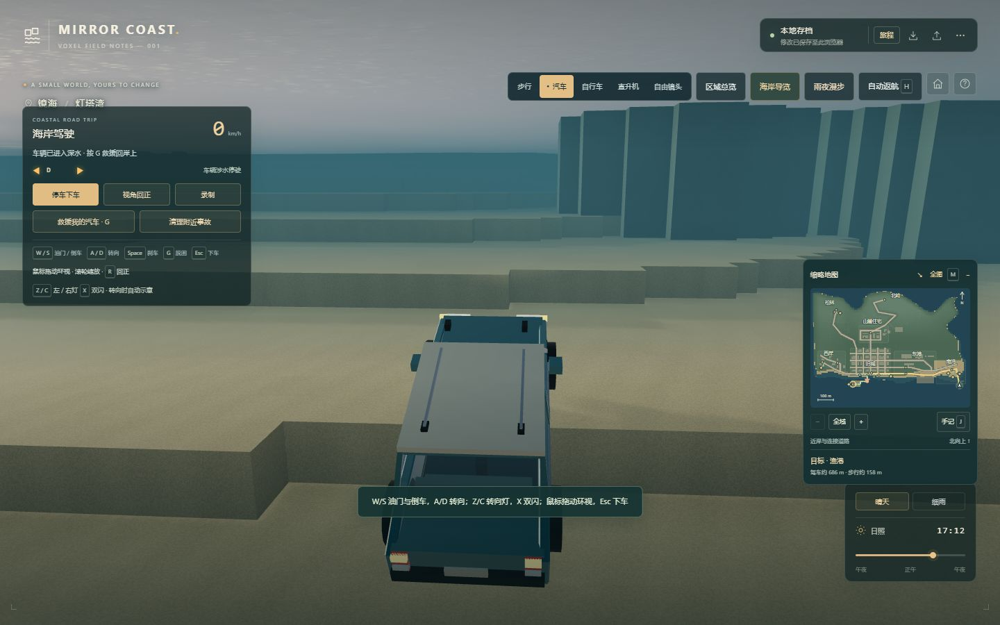
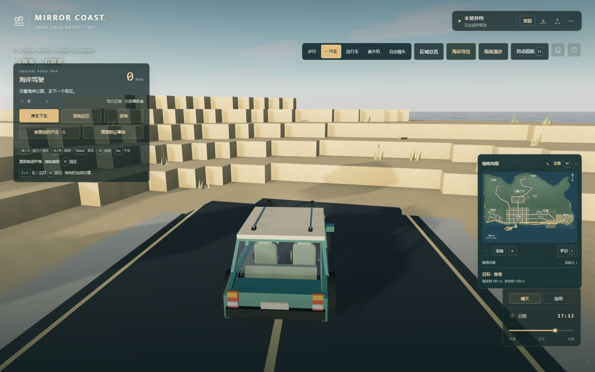

# 海岸行驶与涉水救援

2026-11-17。修复开阔海岸停驶却提示台阶，以及远离公路时 G 救援失败的问题。

## 原因

- 旧车辆支撑检查将地面高度 `<= 12` 一律排除，平整的水线沙地也会报“台阶或落差过大”。几何上有支撑，与是否能在某个水深行驶，混在同一个判断中。
- 汽车救援只检查 80 米内的公路。海滩或海底即使空旷，附近没有铺装道路时仍会失败，提示却要求清障。
- 海面原本仅从上方可见，水下镜头仍显示普通天空和远景。镜头落到海底后，开阔沙床容易被误看成干地。

截图没有坐标，不能据此断言用户当时的准确水深；这里处理的是已确认能复现的同类问题。

## 修改

1. 水面与车辆共用同一海平面常量。轮胎支撑单独判断；水线上的平整地面可以行驶。海岸前方超过允许涉水深度时提示深水，并保留退回岸边的操作。
2. 已经进入深水时停止驱动力，地面支撑和重力继续生效，避免当成台阶或制造悬浮车辆。提示明确给出 G 救援。
3. 手动 G 优先使用原有附近道路搜索，随后检查 32 米内的稳定岸上地面，再检查有限数量的现有道路采样。落点仍核对四轮、整车、障碍和出发方向，不修改世界、不清空存档。
4. 保留原有自动纠错使用的 80 米道路救援入口；扩大的回退只由手动救援调用。
5. 海面两侧都可见。镜头在水下时使用水色雾、较短可见距离和水下光照，离水后恢复正常天空与光照；切换有小幅高度迟滞，避免在水线闪烁。

汽车不支持浮航。本轮提供明确的涉水边界和恢复路径，没有增加船只、游泳或完整水动力系统。

## 验证范围

回归覆盖平整水线沙地行驶、深水边缘刹停与倒车、南湾海底超过原救援半径后的恢复、无铺装道路的沙地、全无安全落点时保持位置，以及水下／出水视觉切换。完整检查 **105 个文件、683 项通过**，生产构建通过。

南湾控制场景位于约 `(700, 240)`，地面为实际区域生成器中的海床；并非移动水面或修改海岸高度来让车辆通过。

独立 Edge 浏览器使用原生存档导入复现该位置，镜头高度约 8.6，低于海平面 12：画面显示水色雾和海面下侧，界面明确提示“车辆已进入深水”。按正常 G 按键后，车辆恢复到约 `(678.61, 133.28)` 的实际道路，距离原位置约 109 米；随后向前驾驶超过 4 米，刹停、导出存档并刷新，车辆位置保持，世界修改记录未变，浏览器无运行错误。该复核使用独立测试存档，没有操作玩家的预览或覆盖玩家存档。

| 水下状态与明确的涉水提示 | 救援回岸后继续驾驶 |
| --- | --- |
|  |  |
