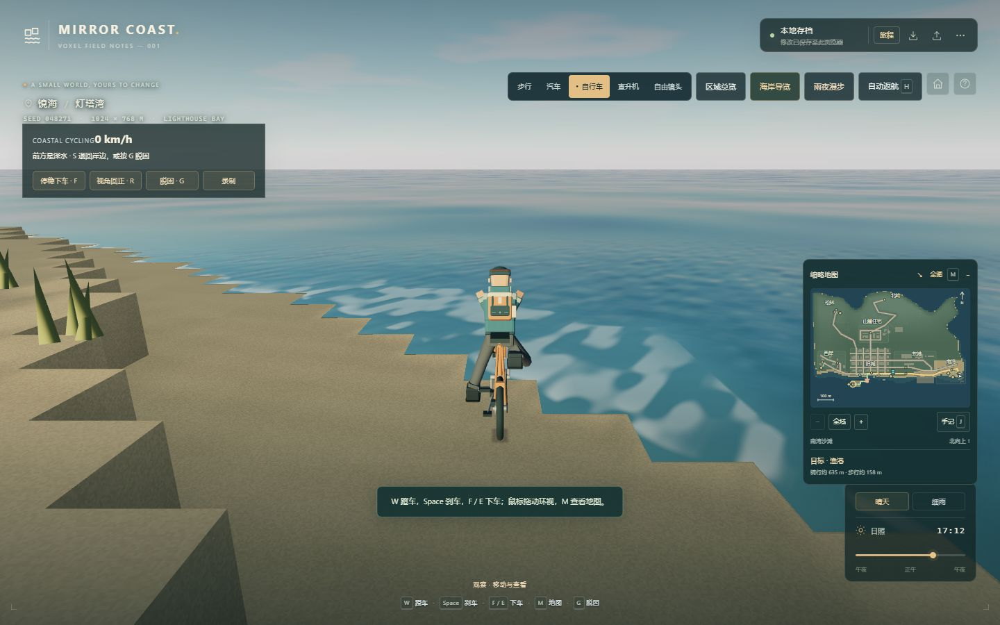
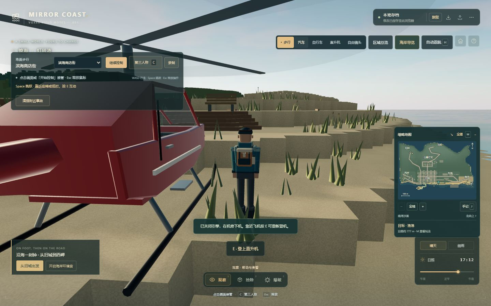

# 人物、自行车与直升机的海岸状态

2026-11-17。沿用现有场景、碰撞、G 脱困、H 返航和存档，只处理海岸通行与水中状态不一致的问题。

## 现在的规则

| 模式 | 水线与岸上 | 深水与脱困 |
| --- | --- | --- |
| 步行 | 水线上的真实沙地可以行走、跳跃；低栏有安全落点时可双向翻越 | 落入深水时明确说明原因，返回重新核验过的岸上落脚点；原落脚点被挖掉后不反复恢复到空洞 |
| 自行车 | 两轮有支撑的沙地可以骑行、刹车、停车及下车 | 前方深水会停车并提示 S 退回、G 脱困；G 检查附近岸地，必要时检查现有道路，包含车身、骑手头部和短距离出发空间 |
| 直升机 | 岸上真实地面停稳后可以 F 下机 | 海面不会被标成已落地；低空有保护拉升与说明。G 可从旧的深水位置恢复到经过完整机身、旋翼和尾部检查的安全空域；H 继续实际飞行返航 |

人物、自行车与汽车共用平均海平面 12 米和浅水深度阈值。几何支撑与涉水限制分别判断，不用“台阶”来解释深水，也不把水面当成实体地板。

海面读取地表的实际顶面高度，在每个体素列的中心判断是否被陆地遮挡。水线沙地不再被波浪盖成海面；挖除后水面遮挡随权威地表更新。修复这一项来自实机截图中“自行车像停在水上”的视觉问题。

已核验的下机落点优先使用请求高度附近的真实地面。低海滩下机时，不会因上方旋翼落在宽范围恢复搜索内，就把人物抬到旋翼高度。

## 验证

- 修改前复现了平整水线反复返回、自行车误停及错误提示、直升机水面误报落地、深水存档 G 搜索失败，以及岸上水线不能下机等问题。
- 回归覆盖真实南湾海床的远距自行车脱困、失去岸上支撑后的恢复、双向翻栏、水线停车下车、飞机深水恢复后继续飞行，以及地表挖除后的水面高度更新。
- 浏览器使用独立临时 Edge 与原生 JSON 导入／导出，未操作玩家预览，也未覆盖玩家存档。复核点包括南湾 `(700.5, 180.5)` 的真实水线沙地、`(700, 240)` 海床和 `(700, 175)` 岸上停机位。

实机结果：

1. 人物从南湾 `(700.5, 12, 180.5)` 水线沙地向东行走超过 1.8 米；继续靠近深水时明确提示并回到约 `(703.35, 12, 179.5)` 的实地，随后可以向回走。
2. 自行车在同一水线正常出发，到深水边停车并保留原因提示；S 能退回，G 后速度清零，再次骑行超过 1 米，刹停后 F 下车落在车旁沙地。原生导出与刷新后，人物和自行车位置保持一致。
3. 直升机从南湾旧的涉水保存位置使用 G 恢复到水面上方，随后手动前飞，持续下降时由海面保护拦住，不会启用水上下机；刷新后恢复位置一致。
4. 在 `(700, 175)` 沙地下降停稳后 F 下机，机身中心约 14.46 米，人物脚底位于实际沙地 13 米，随后能步行离开。初次实机发现的“下机抬到旋翼高度”已针对性修复并重走该步骤。

两次完整海岸操作后，最后单独复核上述下机落点修复。控制检查保留了水边落差、实体碰撞和海面保护；没有注入运行时位置修改器。脱困及刷新没有改变体素编辑集合，浏览器没有运行异常。

| 深水边界可见，自行车停在实际沙地 | 直升机停稳后下到机旁沙地 |
| --- | --- |
|  |  |

回归检查和生产构建通过。以上复核限于本轮海岸状态与脱困，不等同于整张地图或完整十五分钟路线验收。

本轮没有增加游泳、浮航或水上起降能力，也没有放宽建筑碰撞或清空世界来实现脱困。
