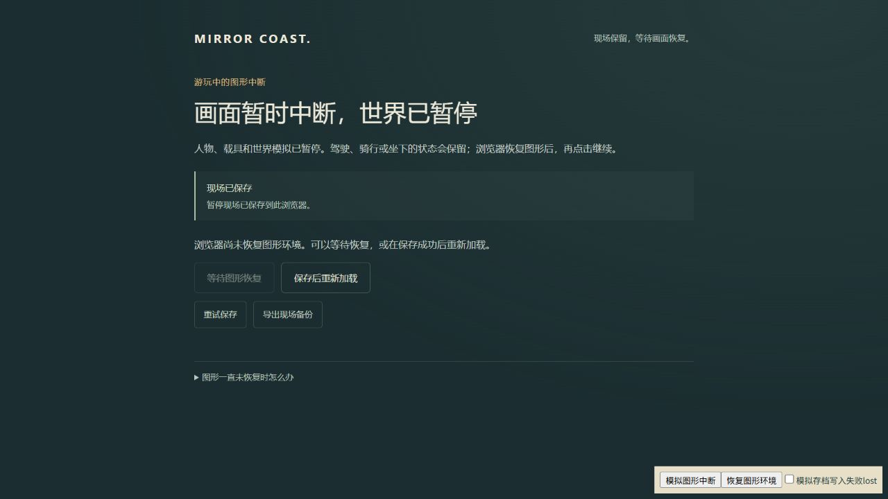

# WebGL 启动失败与存档保护

城市需要 WebGL 2。HTML、按钮和文字能显示，并不表示浏览器已成功创建图形环境；图形加速开关开启时，GPU 进程也可能因崩溃或限制而不可用。

启动失败时显示独立的恢复页面，替换不可使用的游戏控件。页面提供重新加载、错误信息复制、图形加速设置路径、完整重启浏览器的方法和 GPU 诊断指引。只重试当前页面，不会自动重启浏览器或修改系统设置。

1. 点击「重新尝试加载」。这会保留当前网址中的旅程参数。
2. 若仍失败，Edge 在地址栏输入 `edge://settings/system`，Chrome 使用 `chrome://settings/system`，确认图形加速开启。
3. 开关已开但仍无画面时，先保存其他网页未提交内容，再完整重启浏览器。Edge 可输入 `edge://restart`，Chrome 使用 `chrome://restart`。这会重新加载该浏览器的全部标签页；后台运行或启动增强可能让“只关窗口”不能真正结束进程。
4. 若仍失败，在 `edge://gpu` 或 `chrome://gpu` 查看 WebGL 状态，提供「Graphics Feature Status」和「Problems Detected」两段，以及恢复页里的启动错误。不要直接发送包含本机路径等内容的整份诊断报告。

网页无法自行解除浏览器对 WebGL 的禁用。不要为了此类错误清理站点数据或重置世界，那会影响本地存档，也无法修复浏览器的图形进程。

图形环境创建发生在 `WorldPersistence` 初始化之前。该失败分支直接结束启动，不打开、删除或重建存档数据库；复制的信息仅包含启动错误与图形创建错误，不包含世界数据。后续其他启动异常也使用错误页面，但不会声称尚未读取存档。

参考：[Microsoft Edge 图形加速设置](https://learn.microsoft.com/en-us/deployedge/microsoft-edge-browser-policies/hardwareaccelerationmodeenabled)、[Canvas 图形环境创建规则](https://developer.mozilla.org/en-US/docs/Web/API/HTMLCanvasElement/getContext)。

## 内置浏览器实测

本地未发布的测试页拦截 WebGL 2 创建，执行真实的游戏入口，而不是单独展示错误组件：

- 失败后显示恢复页、隐藏画布和游戏控件；存档数据库打开次数 0、删除次数 0。
- 「复制错误信息」正常反馈，不含存档正文。
- 模拟图形恢复后点击重新加载，旅程参数保持，进入同一独立测试旅程；数据库正常打开 1 次、删除次数仍为 0。
- 同时检查了正常渲染、旧城步行近景以及建筑顶部支撑和碰撞。

本轮只操作内置浏览器中的独立测试页面，没有操作用户的桌面、Edge 窗口或游戏存档。

## 游玩中画面中断

浏览器丢失 WebGL 环境时，世界模拟、人物和载具输入会暂停，单独显示恢复页面；不退出驾驶模式，不让车流在看不见的画面里继续运行。页面保存当前位置、世界修改、碎块和驾驶状态。图形环境恢复后仍保持暂停，点击「恢复画面，继续游玩」才恢复模拟，并重新准备环境反射和阴影，避免恢复后场景发黑。

- 「保存后重新加载」先确认保存成功，再重载同一旅程。保存失败或超过八秒仍未确认时，保留当前页面并提示重试，不自动刷新。
- 「导出现场备份」直接导出当前内存里的完整存档，不依赖一次新的数据库写入；原存档尚未成功读取时会拒绝导出，避免把不完整现场当作备份。
- 保存失败时仍可在图形恢复后继续游玩，但会持续提示保存问题，并在离开页面时请求浏览器确认。请保留导出的备份。
- 汽车和手动驾驶直升机的接管状态使用可选存档字段；旧存档仍可读取，世界版本、建筑编号和存档键不变。

本地独立旅程通过真实的 `WEBGL_lose_context` 事件实测了驾驶中暂停、暂停时按键不移动、图形恢复后明确继续、正常光照恢复，以及保存后重载仍处于汽车模式。模拟数据库写入失败时，重载按钮保留页面，现场备份可导出，重试保存后正常继续。

另外检查了新增屋顶的直升机下降接触与再次升空，并在屋顶连续爆破两次、保存重载后继续操作。发现并修正了屋顶只依赖四角、中央被炸穿仍遮挡洞口的问题；屋顶的显示与碰撞现在检查完整底面，重载后也不会重新遮住缺口。这里只代表上述短段实测，不代表已重新完成全路线十五分钟或极端大规模破坏验收。

