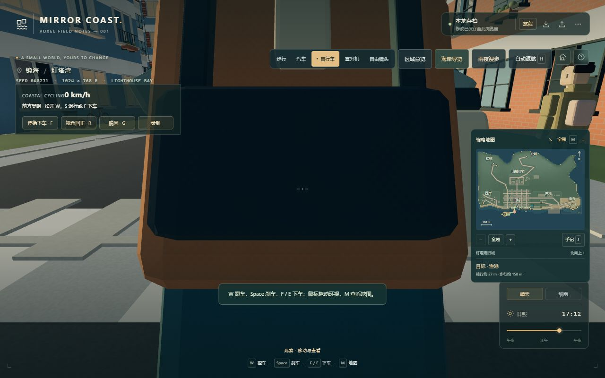
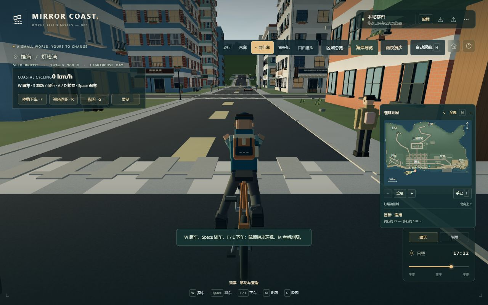
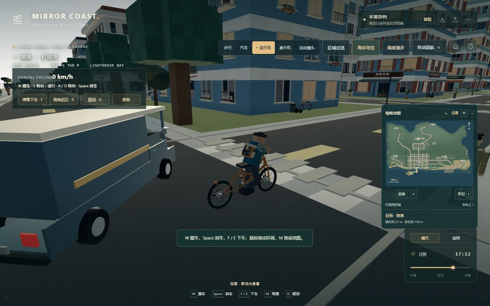

# 斜向车辆旁的通行与镜头

2026-11-17。修复自行车在斜车旁有空间却不能前进的问题，保持现有玩法和地图。

## 原因与修改

车流之前仅向步行、自行车和镜头提供包围整辆车的轴对齐方框。车辆转弯或事故后斜停时，这个方框的空角也会被当成实体。骑手尚未碰到车身，就可能被挡住；同样的范围会将跟随镜头压进人物背包。

- 车流的行驶、转向、事故姿态和手动清障后的碰撞范围保留用于查询的大框，同时提供随真实姿态旋转的车身盒进行接触判断。
- 跟随镜头的多条体积保护射线也检查旋转车身；墙、地形和实际车身继续遮挡镜头。
- G 脱困加入三个载具模式的底部提示、汽车按键说明、直升机按键条及 Tab 帮助。正常通行不依赖脱困。

## 实机对照

独立临时 Edge、1280×800，通过游戏自带 JSON 导入建立相同场景，以普通键盘和界面操作验证，未注入运行时位置修改。测试存档只保留一辆斜停厢式车以隔离这个问题；这不是整城车流压力测试。

车中心约为 `(130, 17.075, 164)`，偏航 45°；自行车从 `(132.1, 16, 161.3)` 朝负 Z 方向骑行。

| 项目 | 原线上版 | 修复版 |
| --- | --- | --- |
| 按住 W 约 2.5 秒 | 移动 0 米，提示受阻 | 前进约 9 米，无受阻提示 |
| 横向位置／高度 | 保持原位 | 保持原横向位置和路面高度 |
| 斜停车辆 | 保持原位 | 保持原位，无移动或删除 |
| 正后方默认镜头 | 被挤入背包 | 可见骑手、自行车与前方道路 |
| G 提示 | 自行车底部提示缺失 | 自行车、汽车、直升机底部均可见 |

以下两张是同一出发位置、未拖动环视前的默认镜头：

| 原版误阻挡与过近镜头 | 修复后的同一位置 |
| --- | --- |
|  |  |

拖动环视后，可看到真实车身与自行车之间的空间：

回归检查覆盖空角前进、真实车身前停止并倒退、转弯及清障后的碰撞同步，以及镜头空角通行／真实车身遮挡。相关测试、TypeScript 检查和生产构建通过；实机检查没有页面异常。

本次不代表所有事故夹挤、动态接触或狭窄镜头均已验收；真实被夹住的情况仍可使用 G，附近事故仍使用手动清理。
