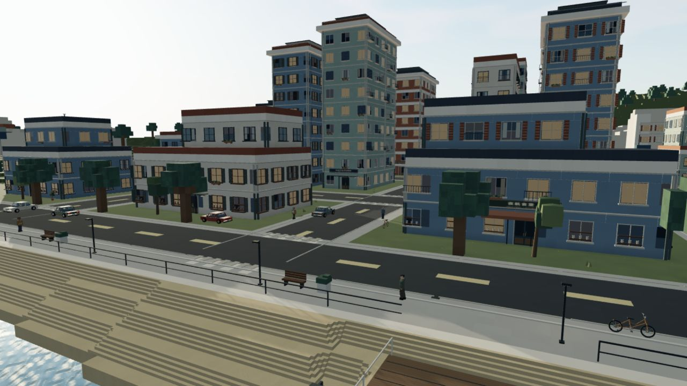
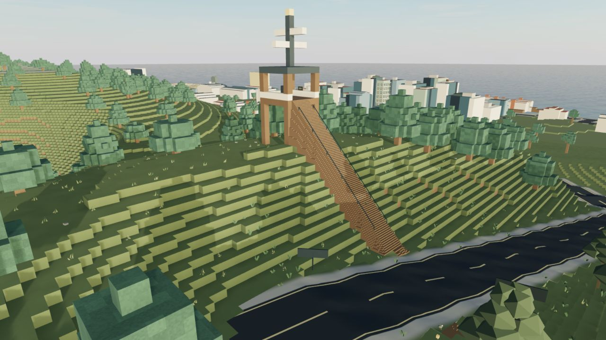
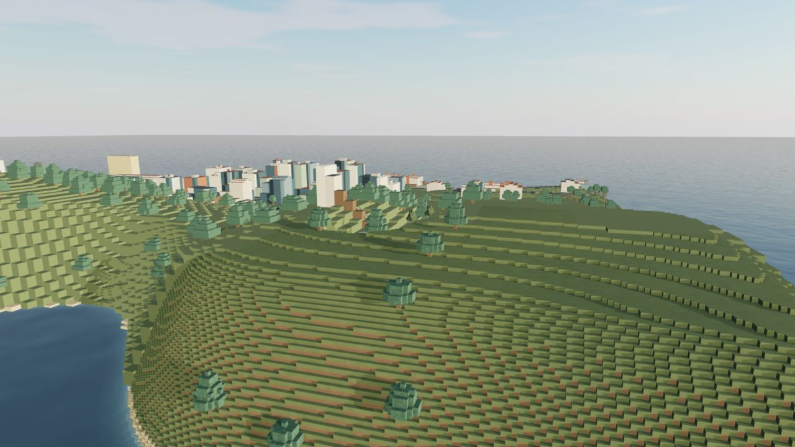

# 植被造型与远景修正

本轮覆盖主场景的全部树木生成来源：329 棵注册体素树（其中旧城 15 棵）、当前生成的 59 棵沿路补植树，以及建筑附近的盆栽小树。这里的“全部”指生成来源与数据规则检查；实机画面抽查旧城、松林和远景，不表示逐棵人工绕行。

## 调整内容

- 旧城阔叶树：保留根位置和原有体素所有权，把近似等宽的盒状树冠修成错层、偏置的叶簇，并从原有树冠单元中形成分叉。
- 外围松林：保留分层收尖的树形，去掉仅对角相接的孤立叶块，树尖使用连在树干上的叶片。树冠不再混用草地材质，避免近景出现黄绿横条、远近颜色突变。
- 沿路小树：用共享的轻量叶簇替换扁平多面体树冠，补齐枝干，临近店门的树冠向外生长并修剪入口视线范围。根位置继续作为支撑和存档绑定。
- 盆栽小树：沿用同一叶簇风格；共享几何只有 54 个顶点，没有增加独立叶片或透明贴图。
- 支撑归属：陡坡草皮不再因位于树冠包围范围内而成为树的一部分；未归属于树木或建筑的孤立叶块从初始生成中移除。

## 远景为什么会变成方柱

原来的四米高度格只记录最高表面，树冠因此连同其下方空气一起被画成实心柱。现在注册树木从地形高度采样中分离，树冠按稀疏叶层生成，树干按连续木质段生成，林下空隙和挖断的树干都能保留。

远景树合并到原来的 48 个地形区块批次中，与同一列的精细网格一起切换。没有扩大精细加载范围，也没有给每棵远景树增加独立绘制调用。远景仍会简化局部叶簇，不保证与近景逐体素一致。

## 存档与验证

树形修正在保存修改加载前执行，只裁剪或改用原有树木单元，保留树 ID、根位置和原始所有权范围。已有挖除、爆破和废墟记录随后按原坐标恢复；不需要清空世界。

自动检查覆盖：林下射线可穿过空气、细树干仍可被命中、树干缺口不被远景填回、砍伐后叶层消失及读档不重生、树冠连通性、坡地草皮保护、松树绿色尖顶，以及直升机与补植树冠碰撞和失撑解除。

内置浏览器实测旧城、松林近景和拉远后的轮廓。松林区域挖除、爆破后重新加载同一独立旅程，68 处修改与 4 块落定废墟保留，支撑任务正常完成。没有操作用户的桌面浏览器，也没有重置原有存档。

