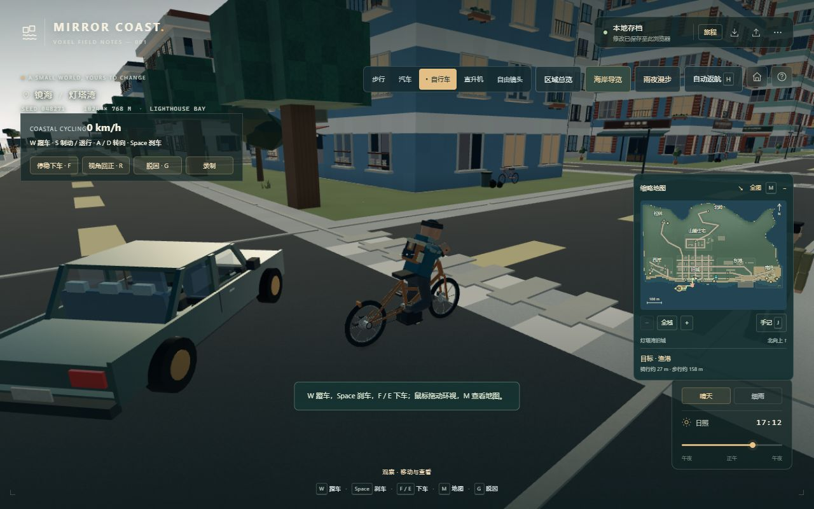
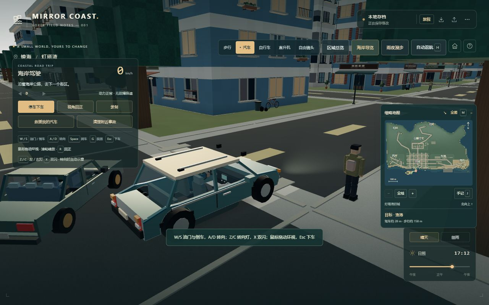
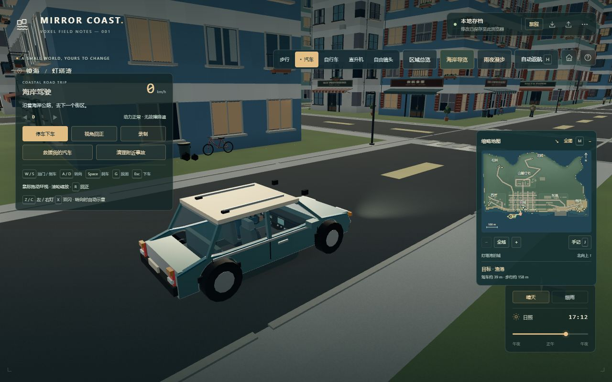

# 载具碰撞范围复核

2026-11-17。在斜向车流误阻挡修复后，继续检查汽车、直升机和自行车的范围来源、姿态更新、附近查询、镜头和救援。保持现有功能与地图。

## 确认并处理的问题

| 链路 | 原问题 | 修改 |
| --- | --- | --- |
| 路边停放车辆 | 碰撞后只更新大方框，车身空角也被当成实体；物理体尺寸还有取整误差 | 保留原存档的车辆坐标系，更新随完整姿态旋转的碰撞盒，并向物理世界传入同一组尺寸 |
| 直升机附近附件 | 比较碰撞缓存时遗漏实际中心和局部尺寸；附件改形后，大框相同时可能沿用旧实体 | 缓存判断包含实际中心、三个局部尺寸和旋转；变化后替换实体，移除后释放 |
| 自行车骑手 | 车架和行走电机的高度不足以覆盖骑行时的帽子，低横梁可能穿头 | 头部有单独碰撞盒，随骑行上身姿势、转向侧倾和坡度变化；不将整个前轮上方变成高墙 |

骑手头部范围对照实际人物几何的角点验证，包含踩踏、脚落地、转向侧倾、上下坡。低横梁会阻挡，有足够净高的通道继续可骑行。附近行人的双向脱离规则继续保留。

## 其余链路核对

- 汽车的车身、保险杠、后视镜与救援净空采用旋转范围；坡地仍核对轮胎和车壳。没有整体缩小车体来放行。
- 直升机物理体分为机身、起落架、旋翼、尾梁和尾翼。主旋翼使用完整扫掠圆盘，不能仅按某一帧可见桨叶的宽度判断能否通过。返航规划继续保留安全余量。
- 自行车对外的范围随坡度更新；下车后停用骑手头部范围，停放车架继续有碰撞。
- 附近空间索引已将带 `trafficId` 的停放车作为动态对象查询，位移不依赖旧的静态格子。物理拥有的实体不会再复制成静态附件。
- 三类载具共用的镜头保护检查真实旋转范围。G 救援仍验证安全目的地，不删除障碍或改变正常通行规则。

## 验证范围

新增回归使用实际停放车、实际物理体及实际人物模型，覆盖：两种原始停车朝向、事故后旋转与旧位置释放、汽车真实绕行、汽车／飞机附件范围更新、头部净高和帽子几何。全量 **103 个文件、671 项检查通过**，TypeScript 与生产构建通过。

页面验证使用独立临时 Edge，通过游戏自己的 JSON 导入、正常按键和导出建立事故场景，不使用运行时传送或位置修改器。停放事故车为 ID 18，位置约 `(130, 16.675, 164)`、偏航 45°；其他交通暂时移除以隔离问题。自行车从 `(132.1, 16, 161.3)` 出发，汽车从 `(132.8, 16.85, 161)` 出发，均向负 Z 方向行驶。

- 自行车沿原横向位置前进约 6.45 米，汽车前进约 9.63 米，均未使用 G 或移动事故车。
- 两组原生导出、刷新和重新导出后，事故车位置保持一致，世界编辑集合一致。
- 直升机从旧城立面前受阻位置按 G 上移约 2 米，再手动倒飞约 6.48 米；本组检查页面无异常。
- 头部低横梁检查使用实际人物几何与模拟移动；不将它描述为已在所有商店雨棚下逐一实测。

以下为实际通行起点的环视画面：

| 自行车旁的斜停车辆 | 汽车旁的斜停车辆 |
| --- | --- |
|  |  |

本记录针对上述链路和场景，不等同于穷举所有事故组合、所有狭缝或完成触屏验收。
